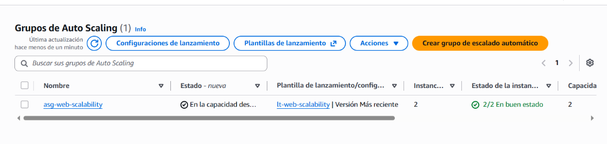
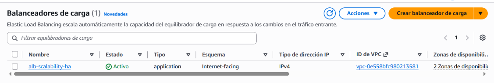
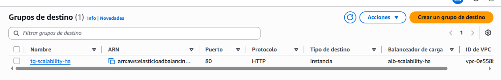
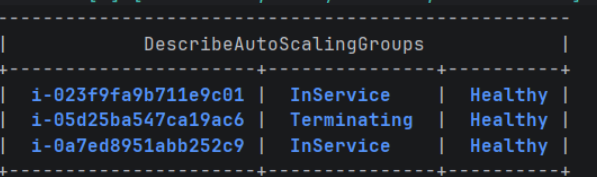
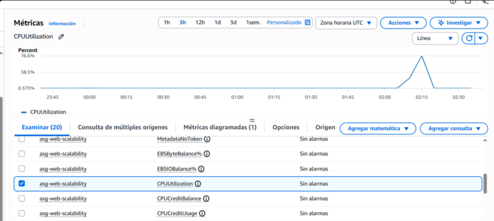
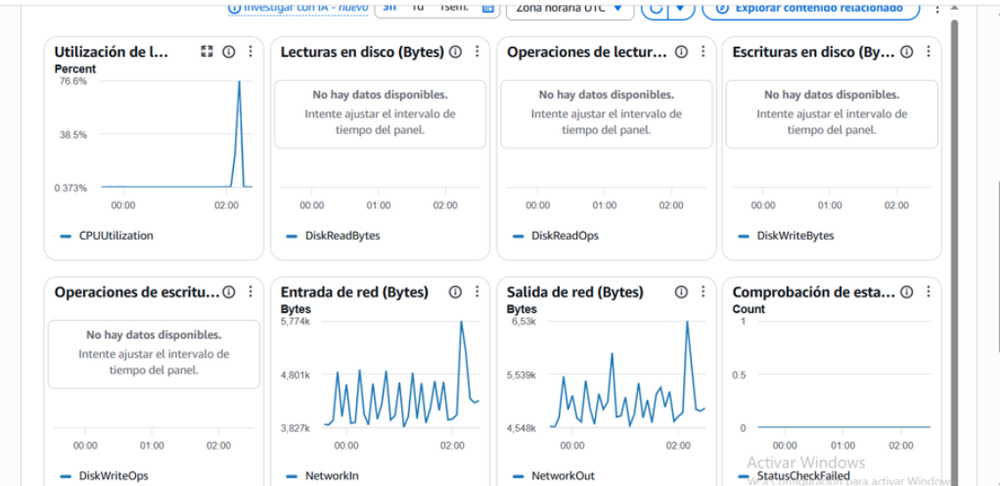
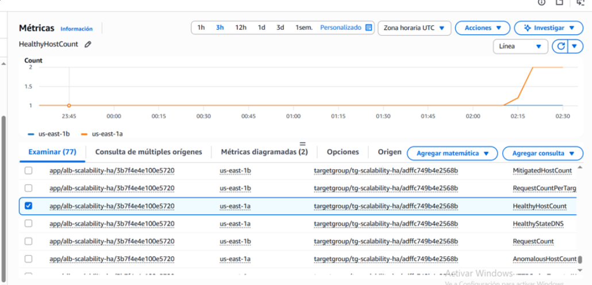
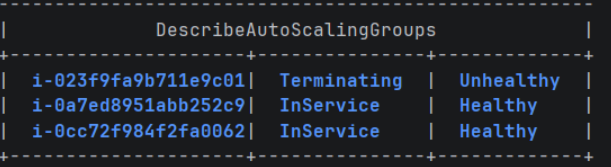
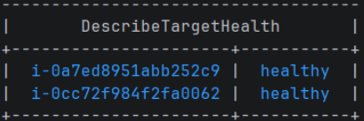

# Reto Final: Escalabilidad, Alta Disponibilidad y Observabilidad en AWS

**Asignatura:** Arquitecturas de Software
**Estudiante(s):** Adrián Ducuara _(verifica el nombre; si trabajaron en pareja, añade al compañero)_
**Plataforma:** AWS Academy Learner Lab
**Región:** us-east-1 (N. Virginia)
**VPC:** vpc-0e558bfc980213581

---

## 1. Diagrama de arquitectura implementada

```
Usuario / Navegador / curl
          |
          v
Application Load Balancer (alb-scalability-ha)
DNS público
          |
          v
Target Group (tg-scalability-ha)
Health check: /health
          |
     +----+----+----+
     v    v    v
   EC2   EC2   EC2
  Web A Web B Web C
 AZ-1a  AZ-1b (si escala)

Auto Scaling Group (asg-web-scalability)
Min: 2 | Max: 3 | Desired: 2
Política: Target Tracking - CPU promedio 50%
```

Componentes creados:

| Elemento | Nombre | Función |
|---|---|---|
| Security Group ALB | `sg-alb-scalability` | HTTP (80) desde `0.0.0.0/0` |
| Security Group EC2 | `sg-ec2-scalability` | HTTP (80) únicamente desde `sg-alb-scalability` |
| AMI | `ami-web-scalability-arsw` | Imagen base con Apache y stress-ng |
| Launch Template | `lt-web-scalability` | Plantilla de lanzamiento para el ASG |
| Target Group | `tg-scalability-ha` | Registro automático de instancias, health check en `/health` |
| Load Balancer | `alb-scalability-ha` | Internet-facing, distribuye tráfico HTTP en 2 AZ |
| Auto Scaling Group | `asg-web-scalability` | Min 2, Max 3, Desired 2, política de CPU al 50% |

---

## 2. Captura del Auto Scaling Group

El grupo `asg-web-scalability` usa el Launch Template `lt-web-scalability` (versión Más
reciente), con capacidad deseada 2 e instancias `2/2 En buen estado`.



---

## 3. Captura del Load Balancer

`alb-scalability-ha`: Application Load Balancer, estado `Activo`, esquema
Internet-facing, IPv4, desplegado en 2 zonas de disponibilidad.



---

## 4. Captura del Target Group con targets Healthy

`tg-scalability-ha`: tipo destino Instancia, protocolo HTTP puerto 80, asociado a
`alb-scalability-ha`, con health check en `/health`.



---

## 5. Evidencia de respuesta desde varias instancias

Se realizaron múltiples peticiones consecutivas al DNS del balanceador. Las respuestas
alternaron entre instancias distintas, cada una reportando su propio Instance ID y zona
de disponibilidad (us-east-1a / us-east-1b), confirmando el balanceo de carga activo.

---

## 6. Evidencia de escalamiento

Se generó carga artificial de CPU con `stress-ng --cpu 2 --timeout 300s` sobre las
instancias del Auto Scaling Group. La política de target tracking detectó el promedio
de CPU por encima del 50% y lanzó una tercera instancia automáticamente, pasando el
grupo de `DesiredCapacity = 2` a `3`. Al terminar la carga, el grupo hizo scale-in y
retiró la instancia adicional (estado `Terminating`), regresando a 2.



---

## 7. Evidencia de métricas en CloudWatch

**CPUUtilization (AWS/EC2, dimensión AutoScalingGroupName = asg-web-scalability):** la
curva muestra el reposo (~0.37%) y el pico generado por `stress-ng`, que alcanzó
**76.6%**, superando el objetivo del 50% de la política.



**Panel de métricas EC2** (CPU, lecturas/escrituras de disco, entrada/salida de red,
StatusCheckFailed = 0):



**HealthyHostCount (AWS/ApplicationELB, por Target Group y AZ):** muestra el incremento
del número de instancias saludables por zona (us-east-1a y us-east-1b), confirmando que
el escalamiento se tradujo en más capacidad real disponible para el balanceador.



Estas tres métricas (una de EC2, una del ALB y el panel agregado) permiten correlacionar
un mismo evento de carga desde tres señales independientes.

---

## 8. Evidencia de falla simulada y recuperación

Se terminó manualmente una instancia (`i-023f9fa9b711e9c01`) para simular una falla
real. El Auto Scaling Group la marcó `Terminating / Unhealthy` y lanzó automáticamente
una instancia de reemplazo (`i-0cc72f984f2fa0062`), sin ninguna acción manual adicional:



El Target Group confirmó ambas instancias sobrevivientes/nuevas como `healthy`, y el
ALB continuó respondiendo sin interrupciones durante todo el proceso:



Esto evidencia la diferencia entre **ocultar una falla** (dejar de enviar tráfico a lo
que falló) y **recuperarse de una falla** (restaurar la capacidad perdida sin
intervención humana).

---

## 9. Análisis de escalabilidad

El Auto Scaling Group implementado usa una política de **target tracking** sobre la
métrica `ASGAverageCPUUtilization`, con un valor objetivo del 50%. Cuando la carga
artificial elevó el promedio de CPU del grupo hasta **76.6%** (visible en la métrica
`CPUUtilization` de la sección 7), CloudWatch disparó la alarma asociada a la política y
el Auto Scaling Group lanzó automáticamente una tercera instancia, pasando de
`DesiredCapacity = 2` a `3`, sin intervención manual del administrador.

Es importante notar que la capacidad máxima configurada (`MaxSize = 3`) actúa como
techo: el sistema no podría escalar más allá de 3 instancias por más que se sostuviera
la carga. Es una limitación deliberada para controlar costos dentro de AWS Academy, pero
en producción debe dimensionarse según el tráfico esperado.

Una limitación real es que **la CPU no es garantía de la salud percibida por el
usuario**: una aplicación puede sufrir cuellos de botella de memoria, I/O de disco o
latencia de red sin que la CPU se dispare, dejando al sistema sin reaccionar a tiempo.
Por eso, en producción conviene combinar esta política con métricas orientadas a la
experiencia real, como `RequestCountPerTarget` o `TargetResponseTime`.

También se observó **scale-in automático**: al finalizar la prueba, el promedio de CPU
volvió a niveles bajos y el grupo retiró la instancia adicional (estado `Terminating` en
la sección 6), regresando de 3 a 2. Esto demuestra que la elasticidad funciona en ambas
direcciones sin trabajo manual.

---

## 10. Análisis de alta disponibilidad

La arquitectura combina tres mecanismos para sostener la disponibilidad:

1. **Distribución en múltiples zonas de disponibilidad** (us-east-1a y us-east-1b), de
   forma que la pérdida de una zona completa no tumba el servicio.
2. **Health checks activos** del Target Group sobre `/health`, que detectan en segundos
   cuando una instancia deja de responder.
3. **Recuperación automática vía Auto Scaling Group**: a diferencia de un ALB sin Auto
   Scaling, aquí el sistema no solo deja de enviar tráfico a la instancia caída, sino que
   **repone la capacidad perdida lanzando una instancia nueva automáticamente**.

Durante la prueba de falla simulada (sección 8), al terminar la instancia
`i-023f9fa9b711e9c01` el grupo la marcó `Unhealthy` y lanzó su reemplazo
(`i-0cc72f984f2fa0062`) sin ninguna acción manual, quedando ambas instancias
sobrevivientes/nuevas como `healthy` en el Target Group. El servicio siguió respondiendo
desde las instancias sanas mientras la nueva completaba su arranque y validación de
salud. Esto evidencia la diferencia entre **ocultar una falla** (dejar de enviar tráfico
a lo que falló) y **recuperarse de una falla** (restaurar la capacidad perdida sin
intervención humana) — la segunda es la que realmente sostiene la disponibilidad a largo
plazo sin depender de que un operador esté disponible para reaccionar.

---

## 11. Análisis de observabilidad

Las métricas revisadas en CloudWatch permitieron correlacionar señales independientes
con un mismo evento:

- **CPUUtilization** (AWS/EC2, dimensión `AutoScalingGroupName`): mostró el pico de carga
  artificial, subiendo de ~0.37% a **76.6%** y volviendo a la normalidad al terminar la
  prueba.
- **HealthyHostCount** (AWS/ApplicationELB, por Target Group y zona): mostró el
  incremento real del número de instancias saludables por AZ, confirmando que el
  escalamiento no fue solo una decisión interna del ASG, sino que se tradujo en más
  capacidad disponible para el balanceador.
- **Panel de métricas EC2** (red, disco, `StatusCheckFailed = 0`): confirmó que las
  instancias se mantuvieron sanas a nivel de infraestructura durante la prueba.

La observabilidad implementada es básica (sin CloudWatch Agent, por restricción del
entorno), por lo que solo se tiene visibilidad de métricas de infraestructura (CPU, red,
conteo de hosts) y no de métricas internas de la aplicación (uso de memoria del proceso,
latencia interna, errores de aplicación). En producción, esto se complementaría con logs
estructurados y trazas distribuidas para una observabilidad de extremo a extremo.

---

## 12. Propuesta de mejora para producción

- **HTTPS con AWS Certificate Manager (ACM):** listener HTTPS (443) con certificado
  gestionado, redirigiendo todo el tráfico HTTP a HTTPS.
- **Instancias en subnets privadas:** eliminar IP públicas de las EC2, dejando el ALB
  como único punto de entrada, con un NAT Gateway para tráfico saliente.
- **Métrica de escalamiento más representativa:** combinar CPU con
  `RequestCountPerTarget`, más cercana a la carga real percibida por los usuarios.
- **CloudWatch Alarms y notificaciones:** alarmas explícitas que notifiquen a un canal
  de operaciones ante escalamientos o caídas de instancias.
- **Logs centralizados:** access logs del ALB hacia S3, y CloudWatch Agent (cuando el
  entorno lo permita) para métricas de memoria y logs de aplicación.
- **Despliegues sin downtime:** Instance Refresh con `MinHealthyPercentage` controlado.
- **Base de datos altamente disponible:** RDS Multi-AZ o Aurora si la aplicación tuviera
  persistencia, para que la BD no sea el nuevo punto único de falla.
- **Infraestructura como código:** migrar la creación manual a Terraform o
  CloudFormation, para reproducibilidad y control de versiones.

---