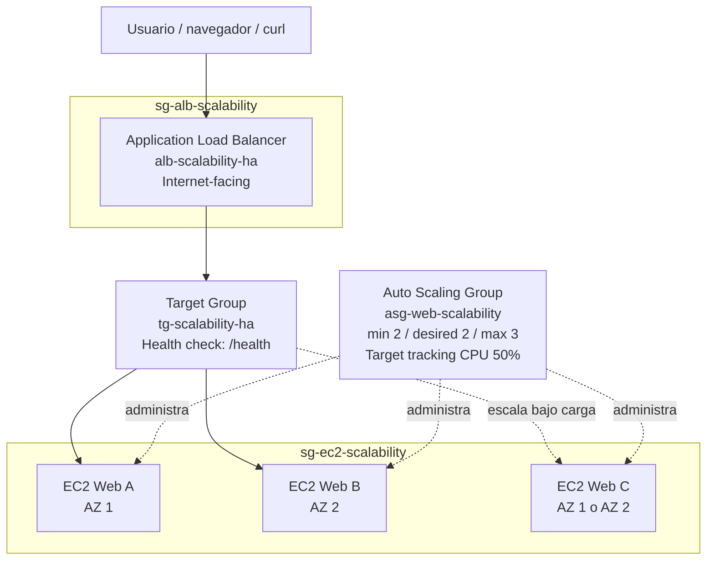

# Diagrama de arquitectura

Arquitectura objetivo del laboratorio: tráfico de Internet entrando por un Application
Load Balancer, distribuido hacia un Target Group con health checks en `/health`, cuyas
instancias son administradas por un Auto Scaling Group repartido en dos zonas de
disponibilidad.

## Componentes y responsabilidad

| Componente | Responsabilidad |
|---|---|
| Application Load Balancer | Recibe tráfico HTTP público y lo distribuye entre targets saludables |
| Target Group | Agrupa instancias y ejecuta health checks (`/health`) para decidir quién recibe tráfico |
| Auto Scaling Group | Lanza/termina instancias EC2 según capacidad deseada, health checks y política de escalamiento |
| Launch Template | Plantilla (AMI, tipo de instancia, Security Group) usada por el ASG para lanzar instancias |
| CloudWatch | Recolecta métricas (CPU, RequestCount, HealthyHostCount, etc.) que alimentan la política de escalamiento y la observabilidad |

Este diagrama corresponde a la sección 4 de la guía oficial del laboratorio.
